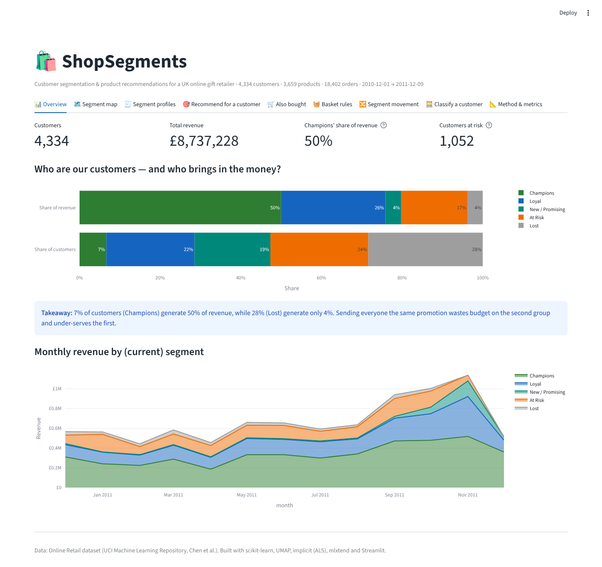
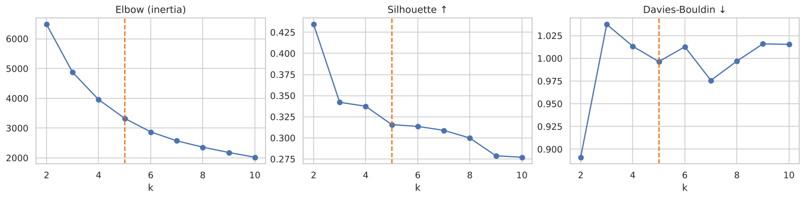
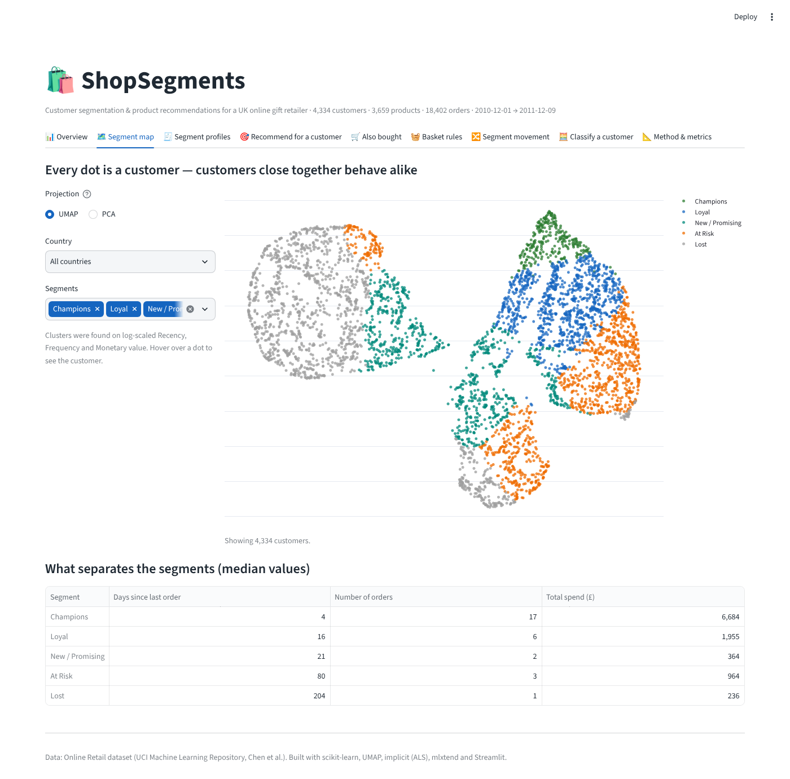
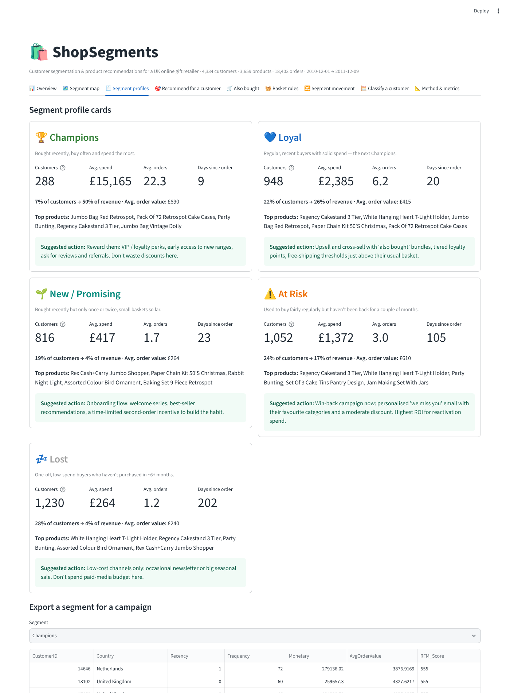
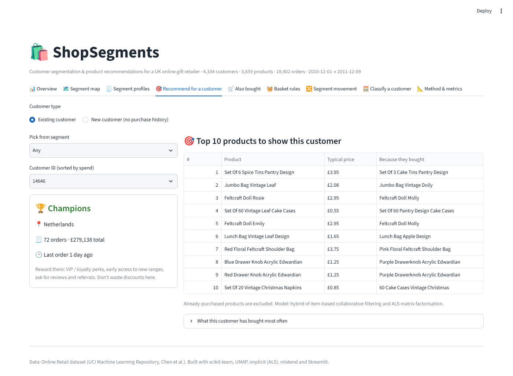
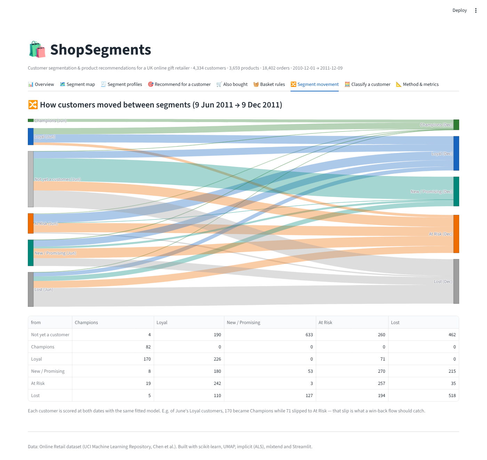

# 🛍️ ShopSegments — Customer Segmentation & Product Recommender

Online stores send the same promotions to everyone and waste money. **ShopSegments** groups e-commerce customers by
behaviour (RFM + K-Means) and recommends the right products to each one (item-based CF + ALS), in a Streamlit
dashboard a marketing team can use without any ML background.

**🔗 Live demo:** https://shopsegments-hwybxm6sydy2hh37e9gzrd.streamlit.app/ · **🎥 Demo video:** `<add Loom/YouTube link>`



---

## Problem

* 7% of customers bring in **50%** of revenue, while 28% bring in 4%. One generic campaign under-serves the first
  group and wastes budget on the second.
* The catalogue has ~3,700 products with a long tail, so customers rarely find the products they'd actually buy.

**Goal:** (1) turn transactions into named, actionable customer segments, (2) recommend products per customer and per
product, (3) handle brand-new customers sensibly.

## Dataset

[Online Retail](https://archive.ics.uci.edu/dataset/352/online+retail) (UCI ML Repository, Chen et al. 2012): every
transaction of a UK-based online gift retailer from **01 Dec 2010 to 09 Dec 2011**. 541,909 rows, 8 columns. Many
customers are small shops/wholesalers. The project also accepts the *Online Retail II* CSV (Dec 2009 – Dec 2011): the loader renames its columns and keeps only the 2010-12-01 → 2011-12-09 window, so results are identical.

| After cleaning | |
|---|---|
| Rows kept | 391,150 (72%) |
| Customers | 4,334 |
| Products | 3,659 |
| Orders | 18,402 |

Cleaning: dropped rows without `CustomerID` (25%), cancellations, non-positive qty/price, non-product codes
(`POST`, `DOT`, `M`, `BANK CHARGES`…), and exact duplicates. Monetary outliers (big wholesalers) are **kept** and
handled with a log transform.

## Approach

```
raw CSV ─► clean ─► RFM table ─► log1p + StandardScaler ─► K-Means (k=5) ─► named segments ─► UMAP / PCA map
                │
                └─► customer × product matrix ─► Popularity │ Item-CF │ ALS │ Hybrid ─► top-10 per customer
                                                └─► also-bought table · FP-Growth basket rules · segment movement
```

### 1 · EDA — 10 insights ([notebook, sections 1-4](notebooks/shopsegments_model.ipynb))

| # | Insight |
|---|---|
| 1 | Revenue roughly **doubles in Sep–Nov** (pre-Christmas): £1.14M in Nov vs £0.44M in Feb |
| 2 | UK = 90% of customers / 83% of revenue; the Netherlands, EIRE & Australia have a few very high-spend accounts |
| 3 | **Top 20% of customers = 75% of revenue**, top 1% = 32% |
| 4 | **35% of customers bought only once**; median customer has 2 orders |
| 5 | No orders on Saturdays; Thursday is the busiest day |
| 6 | Orders peak at noon in office hours → buyers are mostly businesses |
| 7 | Baskets are big: median order has 15 distinct products, worth ~£300 |
| 8 | Cheap items in multiples: median unit price £1.95, median quantity 6 |
| 9 | Long tail: 10% of products make 61% of revenue |
| 10 | New-customer acquisition halved mid-2011, then recovered for Christmas |

### 2 · Segmentation ([notebook, section 5](notebooks/shopsegments_model.ipynb))

RFM = **R**ecency (days since last order), **F**requency (# orders), **M**onetary (total spend). Raw F and M have
skew > 10, so features are `log1p` → `StandardScaler` before clustering.

**Choosing k (stats + business sense):**

| k | 2 | 3 | 4 | **5** | 6 | 7 |
|---|---|---|---|---|---|---|
| Silhouette | 0.434 | 0.342 | 0.337 | **0.316** | 0.314 | 0.309 |

k = 2 scores best but only splits active vs inactive. Silhouette is nearly flat from 3–6. At k = 4 active regulars and
lapsing buyers sit in one cluster; **k = 5 separates *Loyal* from *At Risk*** — groups needing opposite campaigns
(upsell vs win-back). K-Means beat Gaussian Mixture (silhouette 0.15) and DBSCAN (no density gaps in RFM space → one
blob + noise).



| Segment | Customers | Revenue share | Median days since order | Median orders | Suggested action |
|---|---|---|---|---|---|
| 🏆 Champions | 288 (7%) | **50%** | 4 | 17 | VIP perks, early access, referrals — no discounts |
| 💙 Loyal | 948 (22%) | 26% | 16 | 6 | Cross-sell bundles, loyalty tiers |
| 🌱 New / Promising | 816 (19%) | 4% | 21 | 2 | Onboarding + 2nd-order incentive |
| ⚠️ At Risk | 1,052 (24%) | 17% | 80 | 3 | Personalised win-back now |
| 💤 Lost | 1,230 (28%) | 4% | 204 | 1 | Low-cost channels only |

Names are assigned automatically from each cluster's medians, and agree with classic RFM quintile scores
(Champions ≈ 5/5/5, Lost ≈ 1.6/1.7/1.6).

### 3 · Recommender ([notebook, sections 6-7](notebooks/shopsegments_model.ipynb))

**Leak-free protocol**
* **Temporal hold-out:** train on orders before **2011-09-09**, test on the next 3 months.
* **Ground truth** = products a returning customer bought in the test window that they had **never bought before**
  (already-bought items are filtered out, so we measure discovery).
* **Hyper-parameters tuned on a separate validation window** (train < 2011-06-09, validate Jun→Sep). The test window is
  used once.

**Final test metrics (1,852 returning customers, k = 10):**

| Model | Precision@10 | Recall@10 | HitRate@10 | NDCG@10 | Catalogue coverage |
|---|---|---|---|---|---|
| Popularity (baseline) | 0.047 | 0.019 | 0.32 | 0.051 | 1.8% |
| Item-based CF (20 neighbours) | 0.097 | 0.051 | 0.48 | 0.109 | **36.0%** |
| ALS (32 factors, α = 1) | 0.097 | 0.049 | 0.50 | 0.112 | 16.5% |
| **Hybrid (Item-CF + ALS, RRF)** | **0.102** | **0.053** | **0.51** | **0.116** | 22.5% |

➡️ The hybrid is **2.2× the popularity baseline** on Precision@10; half of the customers buy at least one of their
10 recommended *new* products within 3 months.

**Cold start:** for 973 customers who first bought after the split, the popularity list gets Precision@10 = 0.082
vs 0.009 for random products (~9×). The app offers *trending (90 days)*, *all-time* and *by-country* lists.

**"Also bought":** cosine similarity between products' buyer sets (≥5 shared buyers). E.g. *Regency Cakestand* →
Regency teacups & saucers, cake tins, teapot.

### 4 · Bonus features
* **Market basket analysis** — FP-Growth association rules on invoices (811 rules with lift ≥ 3), e.g.
  *red spotty napkins + cups → plates* (confidence 0.92, lift 49).
* **Segment movement** — same model applied to June and December snapshots, shown as a Sankey: over a third of June's
  Loyal customers became Champions, while ~70 slipped to At Risk.

## The dashboard

| Tab | What a marketer does there |
|---|---|
| 📊 Overview | Segment sizes vs revenue share, monthly revenue by segment |
| 🗺️ Segment map | Interactive UMAP / PCA map, filter by country & segment, hover for customer details |
| 🧾 Segment profiles | Profile cards (size, spend, top products, action) + **CSV export** for campaigns |
| 🎯 Recommend for a customer | Top-10 with "because they bought…", purchase history; new-customer mode |
| 🛒 Also bought | Pick a product → 10 products its buyers also bought |
| 🧺 Basket rules | Searchable association rules |
| 🔀 Segment movement | Jun → Dec Sankey |
| 🧮 Classify a customer | Enter R/F/M → predicted segment + action |
| 📐 Method & metrics | k selection, algorithm comparison, recommender metrics, by-segment precision |

| | |
|---|---|
|  |  |
|  |  |

## Project structure

```
shopsegments/
├── app.py                      # Streamlit dashboard (reads ./artifacts only)
├── src/shopsegments/
│   ├── data.py                 # loading, cleaning rules, product catalogue
│   ├── rfm.py                  # RFM features + quintile scores
│   ├── segmentation.py         # preprocessing, k selection, K-Means/GMM/DBSCAN, naming, profiles, playbook
│   ├── recommender.py          # Popularity, Item-CF, ALS, Hybrid, hold-out split, metrics, also-bought
│   ├── basket.py               # FP-Growth rules, segment movement
│   └── config.py
├── scripts/
│   ├── download_data.py        # fetches the dataset into data/raw/
│   └── build_artifacts.py      # full pipeline -> ./artifacts (tuning, evaluation, production recs)
├── notebooks/shopsegments_model.ipynb   # one notebook: EDA · RFM · segmentation · recommender · saves models
├── artifacts/                  # small parquet/json files the app loads (~1.5 MB, committed)
├── reports/figures, reports/screenshots
├── tests/test_pipeline.py      # pytest unit tests on synthetic data
├── requirements.txt            # app runtime (light)
└── requirements-dev.txt        # full pipeline + notebooks + tests
```

## How to run

```bash
git clone https://github.com/<you>/shopsegments.git && cd shopsegments
python -m venv .venv && source .venv/bin/activate      # Windows: .venv\Scripts\activate

# just the app (artifacts are already in the repo)
pip install -r requirements.txt
streamlit run app.py

# rebuild everything from raw data
pip install -r requirements-dev.txt
python scripts/download_data.py
python scripts/build_artifacts.py      # ~1-2 min
pytest -q
jupyter lab notebooks/
```

### Run the notebook in Google Colab
1. Upload `notebooks/shopsegments_model.ipynb` to Colab.
2. Upload the dataset CSV and name it `/content/dataset.csv` (original *Online Retail* or *Online Retail II*).
3. Run all cells. The last cells save `segment_model.joblib`, `segment_model.json`, `recommender_model.joblib` and download them as a zip.

### Deploy (Streamlit Community Cloud)
1. Push this repo to GitHub (public).
2. On [share.streamlit.io](https://share.streamlit.io) → **Create app** → pick the repo, branch `main`, file `app.py`.
3. Advanced settings → Python 3.12 or newer. Deploy. The app only installs `requirements.txt` (no ML libs), so it
   starts in under a minute.

## Why there is no "accuracy"

This is unsupervised learning plus a recommender: there is no label to predict, so accuracy does not apply. Quality is measured differently:

| Part | Metric | Result |
|---|---|---|
| Segmentation (K-Means, k = 5) | Silhouette (higher is better, max 1) | 0.316 |
| Recommender (hybrid, hold-out test, top 10) | Precision@10 / Recall@10 / HitRate@10 | 0.102 / 0.053 / 0.510 |
| Recommender vs baseline | Precision@10 vs popularity (0.047) | 2.2x |
| Cold start (new customers, popularity list) | Precision@10 vs random (0.009) | 0.082 |

Precision@10 = share of the 10 recommended products the customer really bought later. 0.10 means about 1 of 10. Each customer buys only a few new products in the test window, so values near 1.0 are impossible. HitRate@10 = 0.51 means about half of customers bought at least one recommended product.

## Limitations
* **One year of data, one retailer** — segments reflect 2011 behaviour; Recency is relative to 9 Dec 2011.
* **25% of rows have no CustomerID** and can't be segmented; cancellations are dropped rather than netted per customer.
* **Mostly B2B buyers** — Monetary is dominated by wholesalers; segment thresholds wouldn't transfer to a pure B2C shop.
* **Recommendations are pre-computed** for known customers (refresh by re-running the build script); the evaluation
  only measures *new-product discovery*, not repeat purchases.
* **No product metadata** (category, images), so cold-start is popularity-based, not content-based.
* Offline metrics ≠ campaign uplift — an A/B test would be the next step.

## Resume bullet
> Built a customer segmentation and recommendation dashboard (K-Means, UMAP, ALS collaborative filtering, Streamlit)
> turning e-commerce transactions into actionable marketing segments; hybrid recommender reached 2.2× the popularity
> baseline on Precision@10 in a leak-free temporal hold-out.
